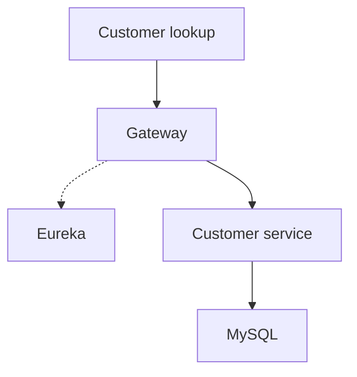
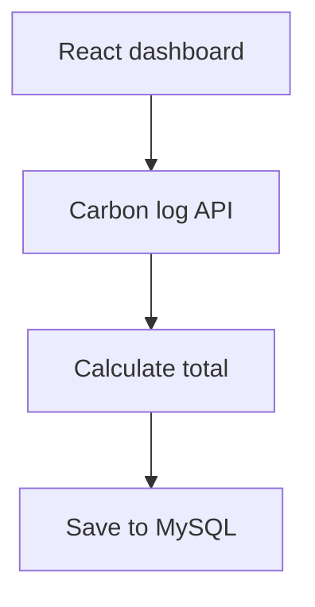
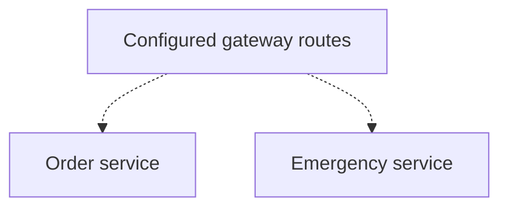

# SRI VILLIAM SAI A

**I build Java and Spring Boot backends and native iOS apps with Swift and SwiftUI. My cloud work includes AWS and Google&nbsp;Cloud.**

My projects span customer APIs, carbon tracking, and iOS apps such as Glassora and Remolad.

  
  
  
  
  
  
  

  
  
  

<table align="center">
<tr>
<td width="33%" valign="top">

### Hire

Java backend, native iOS, and full-stack work with Spring Boot, SwiftUI, and React.

</td>
<td width="33%" valign="top">

### Contribute

Have feedback on a service boundary or local setup? Open an issue.

</td>
<td width="33%" valign="top">

### Reach out

Happy to discuss backend systems, iOS development, and cloud projects.

</td>
</tr>
<tr>
<td valign="top">

[Talk on LinkedIn →](https://www.linkedin.com/in/srivilliamsai/)

</td>
<td valign="top">

[CRM issues](https://github.com/srivilliamsai/CRM_Application/issues) · [PitStop issues](https://github.com/srivilliamsai/pitstop-backend/issues)

</td>
<td valign="top">

[Portfolio →](https://srivilliamsai.vercel.app/)

</td>
</tr>
</table>

| CRM | Carbon Footprint | PitStop |
|:---:|:---:|:---:|
| Customer lookup returned HTTP 200 | Log persisted and read back | Order created and listed |
| [Gateway test](case-studies/crm-application.md#try-it-locally) | [MySQL and Redis tests](case-studies/carbon-footprint.md#try-it-locally) | [Direct API tests](case-studies/pitstop.md#try-it-locally) |

Results from local API smoke tests. The linked case studies show the requests and setup.

## 1. CRM Application

A React dashboard backed by Spring Boot services for customer records, leads, and sales activity. I built the customer API and traced how Spring Cloud Gateway resolves it by service name through Eureka.

<table>
<tr>
<td width="50%" valign="top">

[**CRM Application**](https://github.com/srivilliamsai/CRM_Application) · [Case study](case-studies/crm-application.md)

**Local checks**

- Create a customer through the gateway → HTTP 201
- List customers by company → HTTP 200 with the saved record

</td>
<td width="50%" valign="top">

**Request path**

The auth service validates JWTs for its protected endpoints. The customer lookup uses the company ID as a query filter.

</td>
</tr>
</table>

## 2. Carbon Personal Footprint App

A React dashboard and Spring Boot API for recording the footprint of transport, diet, and energy use. I built the dashboard and API as part of my Infosys internship project.

<table>
<tr>
<td width="50%" valign="top">

**Request path**

The separate emission-factor endpoint caches its simulated lookup in Redis.

</td>
<td width="50%" valign="top">

[**Carbon Personal Footprint App**](https://github.com/srivilliamsai/CarbonPersonalFootprintApp) · [Case study](case-studies/carbon-footprint.md)

**Local checks**

- Submit a log with a bearer token → history returned the saved record
- Look up an emission factor → Redis held the cache key

</td>
</tr>
</table>

## 3. PitStop

A roadside-assistance project with Flutter screens for exploring services and Spring Boot modules for orders and emergency reports.

<table>
<tr>
<td width="50%" valign="top">

[**Flutter app**](https://github.com/srivilliamsai/pitstop) · [**Backend**](https://github.com/srivilliamsai/pitstop-backend) · [Case study](case-studies/pitstop.md)

**Direct API checks**

- Create and list a fuel order → the new order appeared as pending
- Query emergency reports by severity → HTTP 200 with authentication

</td>
<td width="50%" valign="top">

**Service boundaries**

The service endpoints worked directly. The local gateway returned HTTP 503.

</td>
</tr>
</table>

## 4. Swift and iOS development

**Remolad.** One of my native iOS projects.

**Glassora.** I built and published a SwiftUI wallpaper app with category browsing, previews, and favorites. [App Store](https://apps.apple.com/in/app/glassora-wallpapers-hd-4k/id6777764126) · [Launch write-up](https://dev.to/srivilliamsai/i-just-launched-my-first-ios-app-after-16-days-in-app-review-f5b)

## 5. AWS and Google Cloud

**AWS.** I host my portfolio on AWS Amplify and run its assistant backend on AWS Lambda. [Deployment notes](https://github.com/srivilliamsai/portfolio/blob/main/docs/AMPLIFY_RELEASE.md)

**Google Cloud and Firebase.** I work with Google Cloud and use Firebase to manage Glassora’s wallpaper catalog. [Glassora case study](https://main.d229cwpntq8yz1.amplifyapp.com/glassora)

## Writing and background

**Writing.** I wrote about using Kafka events to verify activities and regenerate a resume in a Node.js microservices project. [Project architecture](https://github.com/srivilliamsai/resume-ecosystem-node#%EF%B8%8F-architecture) · [DEV Community article (JSON)](https://dev.to/api/articles/3406775)

**Background.** My Infosys internship project included building the Spring Boot API and React dashboard for the carbon footprint tracker. [Internship project](case-studies/carbon-footprint.md)

`Java` `Spring Boot` `Spring Cloud` `MySQL` `Redis` `Kafka` `React` `Flutter` `Swift` `SwiftUI` `iOS` `AWS` `Google Cloud` `Firebase`

