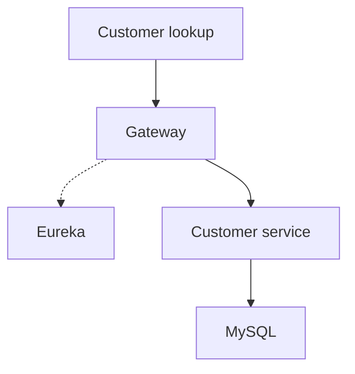
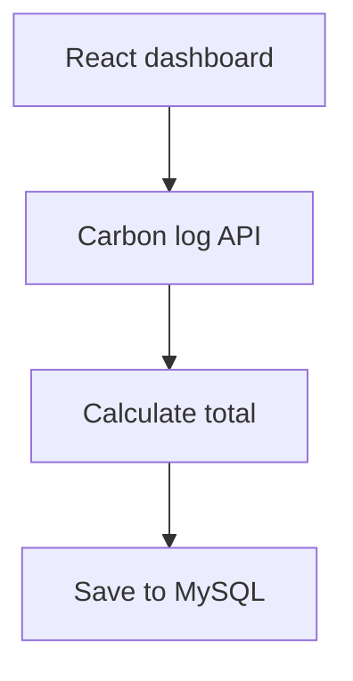
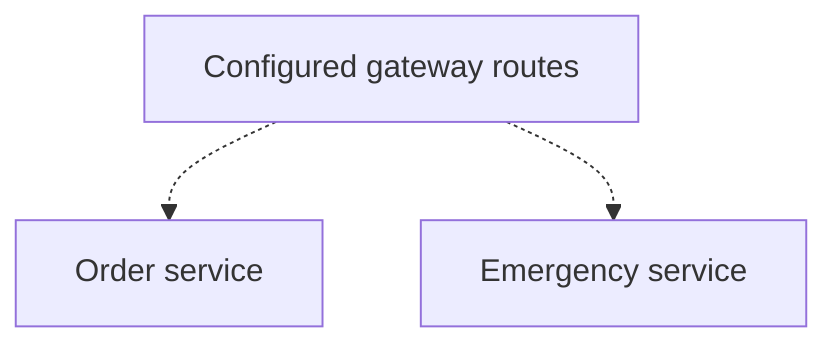

# Sri Villiam Sai A

**I build backend systems with Java and Spring Boot, with a focus on REST APIs, microservices, and service integration.**

Customer lookups through a service gateway. Authenticated carbon logs backed by MySQL. Separate APIs for roadside orders and emergency reports.

  
  
  
  

  
  
  

<table align="center">
<tr>
<td width="33%" valign="top">

### Hire

Java backend and full-stack work with Spring Boot, REST APIs, and React.

[Talk on LinkedIn →](https://www.linkedin.com/in/srivilliamsai/)

</td>
<td width="33%" valign="top">

### Contribute

Have feedback on a service boundary or local setup? Open an issue.

[CRM issues](https://github.com/srivilliamsai/CRM_Application/issues) · [PitStop issues](https://github.com/srivilliamsai/pitstop-backend/issues)

</td>
<td width="33%" valign="top">

### Reach out

Happy to discuss Java, distributed systems, and backend projects.

[Portfolio →](https://srivilliamsai.vercel.app/)

</td>
</tr>
</table>

 

| CRM | Carbon Footprint | PitStop |
|:---:|:---:|:---:|
| Customer lookup returned HTTP 200 | Log persisted and read back | Order created and listed |
| [Gateway test](case-studies/crm-application.md#try-it-locally) | [MySQL and Redis tests](case-studies/carbon-footprint.md#try-it-locally) | [Direct API tests](case-studies/pitstop.md#try-it-locally) |

Results from local API smoke tests. The linked case studies show the requests and setup.

 

## 1. CRM Application

A React dashboard backed by Spring Boot services for customer records, leads, and sales activity. I built the customer API and traced how Spring Cloud Gateway resolves it by service name through Eureka.

<table>
<tr>
<td width="50%" valign="top">

[**CRM Application**](https://github.com/srivilliamsai/CRM_Application) · [Case study](case-studies/crm-application.md)

| Check | Local result |
|---|---|
| Create a customer through the gateway | HTTP 201 |
| List customers for that company | HTTP 200 with the saved record |

</td>
<td width="50%" valign="top">

**Request path**

The auth service validates JWTs for its protected endpoints. The customer lookup uses the company ID as a query filter.

</td>
</tr>
</table>

## 2. Carbon Personal Footprint App

A React dashboard and Spring Boot API for recording the footprint of transport, diet, and energy use. I built the dashboard and API as part of my Infosys internship project.

<table>
<tr>
<td width="50%" valign="top">

**Request path**

The separate emission-factor endpoint caches its simulated lookup in Redis.

</td>
<td width="50%" valign="top">

[**Carbon Personal Footprint App**](https://github.com/srivilliamsai/CarbonPersonalFootprintApp) · [Case study](case-studies/carbon-footprint.md)

| Check | Local result |
|---|---|
| Submit a log with a bearer token | History returned the saved record |
| Look up an emission factor | Redis held the activity-type cache key |

</td>
</tr>
</table>

## 3. PitStop

A roadside-assistance project with Flutter screens for exploring services and Spring Boot modules for orders and emergency reports.

<table>
<tr>
<td width="50%" valign="top">

[**Flutter app**](https://github.com/srivilliamsai/pitstop) · [**Backend**](https://github.com/srivilliamsai/pitstop-backend) · [Case study](case-studies/pitstop.md)

| Direct API check | Local result |
|---|---|
| Create and list a fuel order | The new order appeared as pending |
| Query emergency reports by severity | HTTP 200 with authentication |

</td>
<td width="50%" valign="top">

**Service boundaries**

The service endpoints worked directly. The local gateway returned HTTP 503.

</td>
</tr>
</table>

 

## Writing and background

**Writing.** I wrote about using Kafka events to verify activities and regenerate a resume in a Node.js microservices project. [Project architecture](https://github.com/srivilliamsai/resume-ecosystem-node#%EF%B8%8F-architecture) · [DEV Community article (JSON)](https://dev.to/api/articles/3406775)

**Background.** My Infosys internship project included building the Spring Boot API and React dashboard for the carbon footprint tracker. [Internship project](case-studies/carbon-footprint.md)

 

`Java` `Spring Boot` `Spring Cloud` `MySQL` `Redis` `Kafka` `React` `Flutter`

