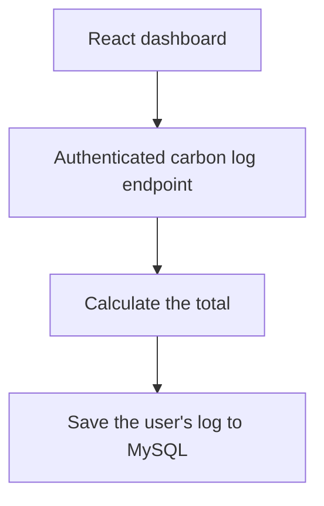

# Carbon Personal Footprint App

The app lets people track their daily footprint from transport, diet, and energy use. I built the React dashboard and Spring Boot API as part of my Infosys internship project.

## Saving a footprint log

The dashboard sends a bearer token and the user's inputs to `POST /api/carbon-logs/add`. The controller looks up the authenticated user, calculates the total with `CarbonService`, and saves the result through JPA to MySQL. The authenticated history endpoint reads the user's saved logs.



The backend keeps emission-factor lookups separate from log writes. `GET /api/external/emission-factor?type=car` calls a Spring-cached method that reads a simulated factor table. Redis stores the result by activity type. The log calculation uses its own fixed coefficients.

[Dashboard request](https://github.com/srivilliamsai/CarbonPersonalFootprintApp/blob/687160bada770395f19fa9fd78fdb67ec5118ae6/frontend/src/Dashboard.jsx#L172) · [Log controller](https://github.com/srivilliamsai/CarbonPersonalFootprintApp/blob/687160bada770395f19fa9fd78fdb67ec5118ae6/src/main/java/com/cpfa/controller/CarbonLogController.java) · [Calculation](https://github.com/srivilliamsai/CarbonPersonalFootprintApp/blob/687160bada770395f19fa9fd78fdb67ec5118ae6/src/main/java/com/cpfa/service/CarbonService.java) · [Cached lookup](https://github.com/srivilliamsai/CarbonPersonalFootprintApp/blob/687160bada770395f19fa9fd78fdb67ec5118ae6/src/main/java/com/cpfa/service/CarbonInterfaceService.java)

## Try it locally

Follow the [repository setup](https://github.com/srivilliamsai/CarbonPersonalFootprintApp#%EF%B8%8F-installation--setup) for Java 17, MySQL, and Redis. Register a test account through `POST /auth/register`, then sign in through `POST /auth/login` and set `TOKEN` to the returned `accessToken`.

```sh
curl --fail-with-body http://localhost:8089/api/carbon-logs/add \
  -H "Authorization: Bearer $TOKEN" \
  -H 'Content-Type: application/json' \
  --data '{"transportMode":"car","dietType":"veg","energyEmission":2}'
```

A local smoke test saved a log and found the same record in `GET /api/carbon-logs/history`. The separate factor lookup also populated the `emissionFactors::car` key in Redis.
