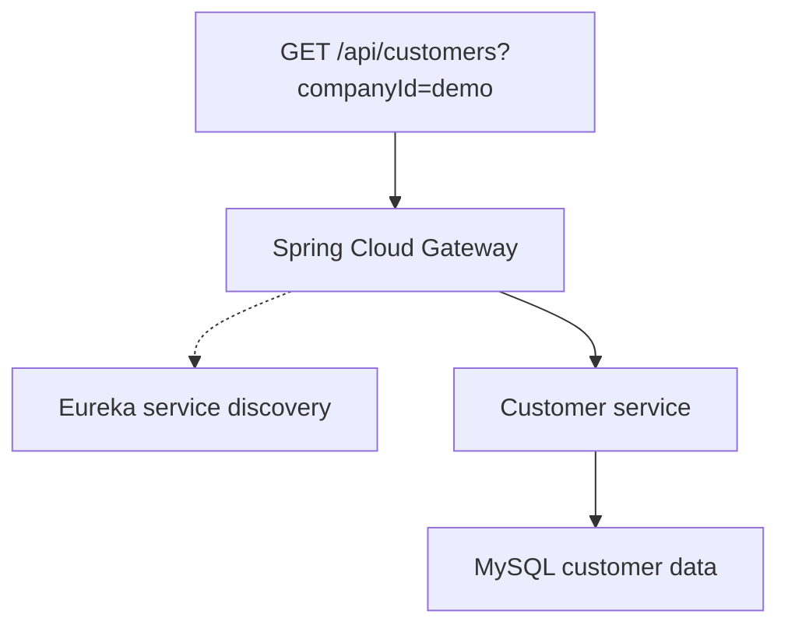

# CRM Application

The CRM brings customer records, leads, and sales activity into a React dashboard. I built the Spring Boot CRM services and their API routes, including a customer service that owns customer data.

## Customer lookup

The gateway maps `/api/customers/**` to `lb://customer-service`. Eureka lets the gateway resolve the service by name so the route can stay the same when the service address changes. The controller takes a `companyId` query parameter and the repository uses it to filter the MySQL query.



The auth service's security filter validates JWTs for its protected endpoints. The gateway forwards customer lookups without a JWT check, and the customer service uses the supplied `companyId` as a query filter. The React client sends customer requests directly to the customer service. The diagram shows the gateway route.

[Gateway routes](https://github.com/srivilliamsai/CRM_Application/blob/24dbf82a0c5ea450fcf249ac6c0e81d24b72cd22/api-gateway/src/main/resources/application.yml) · [Customer controller](https://github.com/srivilliamsai/CRM_Application/blob/24dbf82a0c5ea450fcf249ac6c0e81d24b72cd22/customer-service/src/main/java/com/crm/customer/controller/CustomerController.java) · [Customer service](https://github.com/srivilliamsai/CRM_Application/blob/24dbf82a0c5ea450fcf249ac6c0e81d24b72cd22/customer-service/src/main/java/com/crm/customer/service/CustomerService.java) · [JWT filter](https://github.com/srivilliamsai/CRM_Application/blob/24dbf82a0c5ea450fcf249ac6c0e81d24b72cd22/auth-service/src/main/java/com/crm/auth/config/JwtAuthenticationFilter.java) · [React API client](https://github.com/srivilliamsai/CRM_Application/blob/24dbf82a0c5ea450fcf249ac6c0e81d24b72cd22/frontend/src/services/api.js)

## Try it locally

Follow the [repository setup](https://github.com/srivilliamsai/CRM_Application#how-to-run). For this request, run MySQL, the discovery server, the customer service, and the gateway. Once the customer service registers with Eureka, run the query through the gateway. An empty database returns an empty list.

```sh
curl --fail-with-body 'http://localhost:8080/api/customers?companyId=demo'
```

In a local smoke test, a customer created through the gateway also appeared in the company lookup. The lookup returned HTTP 200 without a bearer token.
