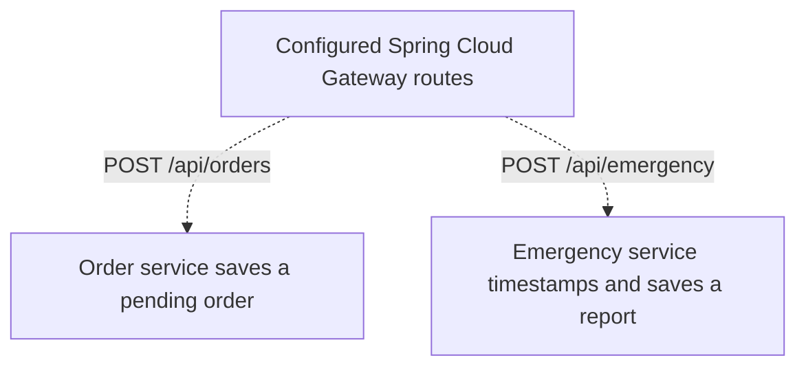

# PitStop

PitStop explores how drivers could request fuel delivery or roadside assistance from a phone. I built Flutter screens for exploring services and viewing orders, and Spring Boot modules for handling order and emergency requests.

## Separate order and emergency routes

The gateway configuration maps orders and emergency reports to different services. Orders have a customer, service type, and status. Emergency reports record an issue, severity, location fields, and a server-assigned timestamp. That lets the emergency service support a severity query while the order service handles the order lifecycle. Both services use MySQL in the current configuration.



The Flutter orders screen displays sample records. The request flow here describes the backend API.

[Flutter orders screen](https://github.com/srivilliamsai/pitstop/blob/78cd88d177a8f23925d525eb88b0ec3320cda9ff/lib/screens/orders_page.dart) · [Gateway routes](https://github.com/srivilliamsai/pitstop-backend/blob/2d22e18e5b6ee048cdfa3ac43af5f700fa5863b9/api-gateway/src/main/resources/application.yml) · [Order controller](https://github.com/srivilliamsai/pitstop-backend/blob/2d22e18e5b6ee048cdfa3ac43af5f700fa5863b9/order-service/src/main/java/com/pitstop/orderservice/web/OrderController.java) · [Emergency controller](https://github.com/srivilliamsai/pitstop-backend/blob/2d22e18e5b6ee048cdfa3ac43af5f700fa5863b9/emergency-service/src/main/java/com/pitstop/emergency/web/EmergencyController.java)

## Try it locally

Follow the [backend setup](https://github.com/srivilliamsai/pitstop-backend#running-the-project). Start MySQL and Eureka, then run the order and emergency modules on their default ports. For a local run that uses the modules' checked-in configuration, pass `--spring.cloud.config.enabled=false` in `spring-boot.run.arguments` for both modules. Use the emergency service's local Spring Security credentials for its severity query.

```sh
curl --fail-with-body http://localhost:8082/api/orders
curl --fail-with-body --user "$PITSTOP_DEV_USER" \
  http://localhost:8086/api/emergency/severity/high
```

A direct smoke test created and listed a pending fuel order and successfully queried emergency reports by severity with authentication. The gateway returned HTTP 503 for both routes in the local run. The services registered with Eureka, but the [gateway module](https://github.com/srivilliamsai/pitstop-backend/blob/2d22e18e5b6ee048cdfa3ac43af5f700fa5863b9/api-gateway/pom.xml) lacks a Eureka client dependency. The commands above use the service ports directly.
